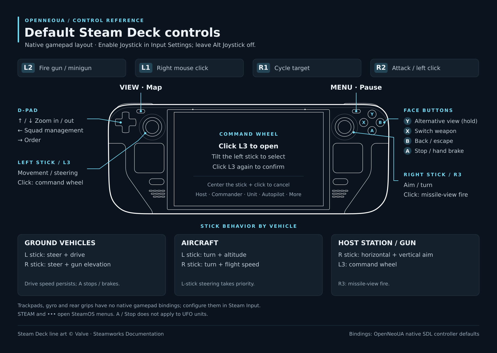

# Steam Deck



## Build

Requires Python 3.9+, Git, and running Docker with `linux/amd64` support. Put your
own Urban Assault base-game ISO at `vendor/ua.iso` (gitignored). From the repository
root:

```sh
mkdir -p vendor
cp "/path/to/Urban Assault.iso" vendor/ua.iso
python3 packaging/steamrt4/dev_menu.py
```

Choose **Build Steam Deck AppImage**. The result is in
`build/steamdeck-private/artifacts/`. Keep the ISO and AppImages containing game
data private.

## Install and play

Configure the `steamdeck` host in `~/.ssh/config` so `ssh steamdeck` connects to
your Deck. In the menu, choose **Deploy latest AppImage**, or use **Build and
deploy** to do both. Deployment installs `~/Applications/OpenNeoUA-dev.AppImage`
and an **OpenNeoUA (Development)** desktop launcher.

On the Deck, switch to Desktop Mode and add **OpenNeoUA (Development)** to Steam
via **Add a Game → Add a Non-Steam Game**. Return to Game Mode and leave
Compatibility off (native Linux; no Proton). In the game's Input Settings,
enable **Joystick** and leave **Alt Joystick** off.

Later deployments update the same shortcut. Saves and settings default to
`~/.local/share/OpenNeoUA`.

## Development and tests

Python packaging tools live in `packaging/steamrt4/`; their asset-free tests live
in `packaging/steamrt4/tests/`. Run the same suite used by CI and the developer
menu with:

```sh
python3 packaging/steamrt4/dev_workflow.py tests
```

C++ tests are registered in `src/tests/CMakeLists.txt` and run through CTest:

```sh
cmake -S src -B build/native -DCMAKE_BUILD_TYPE=Release
cmake --build build/native --parallel
ctest --test-dir build/native --output-on-failure
```

This requires the engine's native development libraries. The filesystem tests
run with AddressSanitizer on Linux and macOS. Use `-DBUILD_TESTING=OFF` for a
production-only build. The standalone upstream clock and geometry tests also
run through CTest; the remaining upstream probes in `src/world/tests/` use the
MSYS2 probe runner and may require an assembled game installation. They are not
part of the asset-free CI suite.

For the full Linux build, tests, and redistributable overlay packaging, run:

```sh
python3 packaging/steamrt4/local_ci.py
```

The rendered smoke test is separate because it needs a private AppImage with
original game assets. It checks Title → Options → Title, screenshots, and clean
shutdown:

```sh
python3 packaging/steamrt4/build_smoketest_image.py
python3 packaging/steamrt4/smoke_test.py --appimage /path/to/OpenNeoUA.AppImage
```

The smoke image builder uses the same sanitized source snapshots as local CI.
Use `--refresh-image` on the smoke test to rebuild its container with `--pull`.
Python tools share runtime pins in `packaging/steamrt4/config.py`; when upgrading
SteamRT4, update the Dockerfiles, workflow, and `run-ci.sh` pins together.
