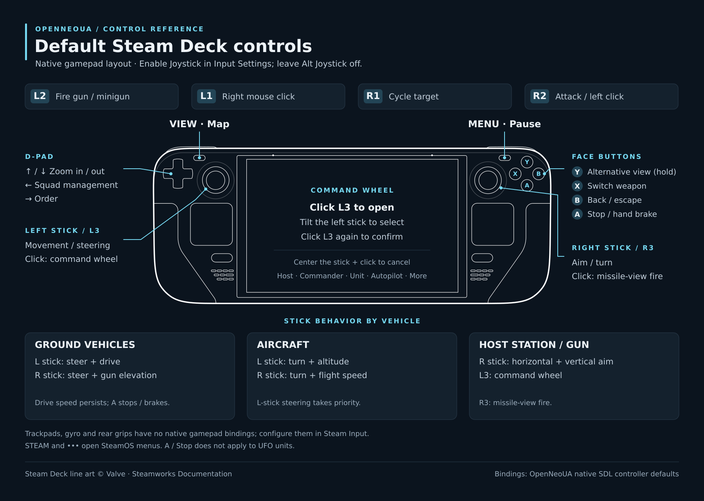

# Steam Deck



## Build

Requires Python 3.9+, Git, and running Docker with `linux/amd64` support. Put your
own Urban Assault base-game ISO at `vendor/ua.iso` (gitignored). From the repository
root:

```sh
mkdir -p vendor
cp "/path/to/Urban Assault.iso" vendor/ua.iso
python3 packaging/steamrt4/dev_menu.py
```

Choose **Build Steam Deck AppImage**. The result is in
`build/steamdeck-private/artifacts/`. Keep the ISO and AppImages containing game
data private.

## Install and play

Configure the `steamdeck` host in `~/.ssh/config` so `ssh steamdeck` connects to
your Deck. In the menu, choose **Deploy latest AppImage**, or use **Build and
deploy** to do both. Deployment installs `~/Applications/OpenNeoUA-dev.AppImage`
and an **OpenNeoUA (Development)** desktop launcher.

On the Deck, switch to Desktop Mode and add **OpenNeoUA (Development)** to Steam
via **Add a Game → Add a Non-Steam Game**. Return to Game Mode and leave
Compatibility off (native Linux; no Proton). In the game's Input Settings,
enable **Joystick** and leave **Alt Joystick** off.

Later deployments update the same shortcut. Saves and settings default to
`~/.local/share/OpenNeoUA`.
